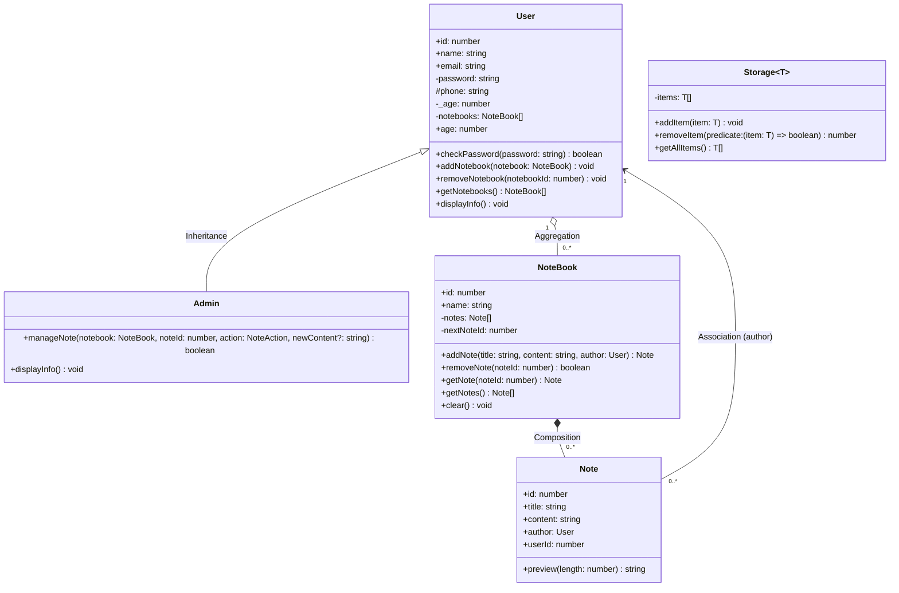

# Notes Management System — TypeScript OOP

A simple notes management system that demonstrates **Inheritance, Composition, Aggregation, Association and Generics** in TypeScript.

## Run

```bash
npm install
npm start
```

## Project Structure

```
src/
├── main.ts            # demo of every requirement
└── models/
    ├── User.ts        # base class (access modifiers + age 18–60 validation)
    ├── Admin.ts       # extends User, manageNote()
    ├── Note.ts        # preview(), author -> User
    ├── NoteBook.ts    # owns its notes: addNote(), removeNote()
    └── Storage.ts     # generic Storage<T>
```

## Part B — UML Class Diagram

`+` public · `-` private · `#` protected



## Relationships

| Relationship | Classes | UML symbol | Explanation |
|---|---|---|---|
| **Inheritance** | `Admin` → `User` | hollow triangle `<|--` | Admin *is a* User and inherits all its properties and methods, adding `manageNote()`. |
| **Composition** | `NoteBook` ◆— `Note` | filled diamond `*--` | NoteBook creates notes inside `addNote()` and owns them; deleting the notebook deletes its notes. A note can't exist without its notebook. |
| **Aggregation** | `User` ◇— `NoteBook` | hollow diamond `o--` | A user owns many notebooks, but notebooks are created separately and keep existing if they're removed from the user. |
| **Association** | `Note` → `User` | plain arrow `-->` | Each note references its author (`author` / `userId`); both live independently. |
| **Generics** | `Storage<T>` | — | Stores any type, e.g. `Storage<User>`, `Storage<string>`. |
